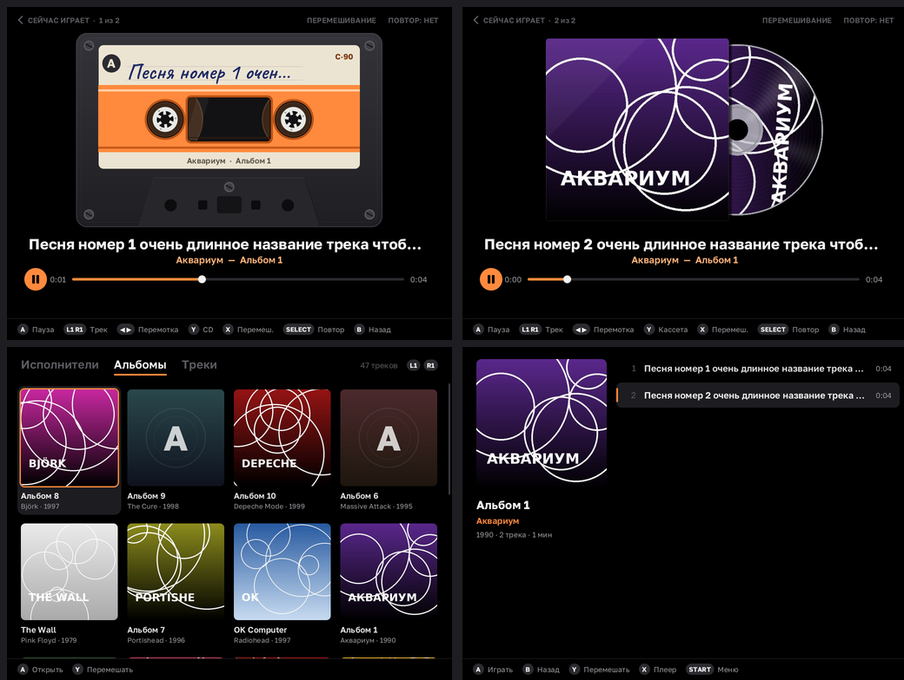
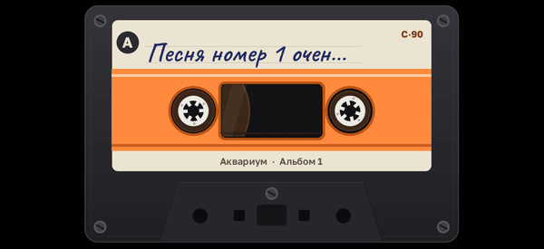
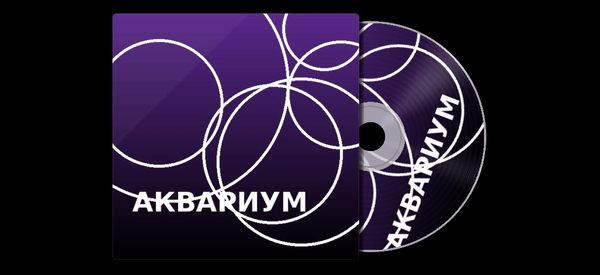

# Кассета (Kasseta)

Музыкальный плеер для **NextUI** на **TrimUI Brick**, Brick Pro и Smart Pro (платформа `tg5040`).



| Кассета | CD |
|---|---|
|  |  |

## Возможности

- Находит музыку **во всех папках карты памяти**: MP3, FLAC, OGG (Vorbis), WAV
- Библиотека по тегам: **исполнители → альбомы → треки**; без тегов — по именам папок и файлов
- Папки `CD1`/`CD2` склеиваются в один альбом, сборники идут в «Разные исполнители»
- **Обложки**: встроенные в файл или `cover.jpg` / `folder.jpg` / `front.jpg` в папке альбома
- Русские теги в cp1251 читаются правильно
- Экран воспроизведения в двух видах: **кассета** с крутящимися катушками и **CD** с вращающимся диском
- Чёрный интерфейс, перемешивание, повтор, перемотка
- Кэш библиотеки: повторный запуск мгновенный, обновление в фоне
- Запоминает трек и позицию между запусками
- POWER гасит экран, музыка продолжает играть

## Установка

1. Скачай `Kasseta-NextUI-tg5040.zip` из [Releases](../../releases).
2. Распакуй в корень карты памяти. Должно получиться `/Tools/tg5040/Kasseta.pak/`.
3. В NextUI открой **Tools → Kasseta**.

Папки `Roms`, `Bios`, `Saves`, `Emus`, `Tools` и скрытые не сканируются. Свои исключения можно дописать в `skip.txt`.

## Управление

| | Библиотека | Плеер |
|---|---|---|
| Крестовина | выбор | ◀ ▶ перемотка, ▲ ▼ кассета/CD |
| A | открыть / играть | пауза |
| B | назад | назад |
| X | экран плеера | перемешивание |
| Y | перемешать | кассета/CD |
| L1 / R1 | вкладки | пред. / след. трек |
| L2 / R2 | пред. / след. трек | пред. / след. трек |
| SELECT | пауза | режим повтора |
| START | меню | меню |
| POWER | выключить экран | выключить экран |
| MENU | выход | выход |

При выходе музыка останавливается: NextUI запускает одно приложение за раз.

Лог ошибок: `/.userdata/tg5040/logs/Kasseta.txt`

## Сборка

Нужны `clang`, `lld`, `llvm-nm`, `python3`, `git`, `zip`. ARM-тулчейн и Docker **не нужны**: бинарник собирается clang'ом под aarch64 и линкуется с заглушками системных библиотек (`toolchain/xbuild.py`), а на устройстве подхватывает настоящие glibc и SDL2 из прошивки.

```sh
./build.sh
```

Результат: `Kasseta-NextUI-tg5040.zip`.

Тест без устройства (рендерит все экраны в PNG, проверяет декодеры):

```sh
./tools/test/run.sh
```

## Устройство кода

| Файл | Что делает |
|---|---|
| `src/main.c` | SDL2: окно, звук, кнопки, подсветка экрана |
| `src/ui.c` | экраны, навигация, очередь, кассета и CD |
| `src/library.c` | сканирование карты, кэш, группировка |
| `src/tags.c` | ID3v1/v2, FLAC, Vorbis comments, WAV INFO, длительность |
| `src/audio.c` | декодирование и ресемплинг |
| `src/covers.c` | фоновая загрузка обложек |
| `src/gfx.c` | программная отрисовка: фигуры со сглаживанием, текст, картинки |

## Лицензии

Код плеера — MIT (см. `LICENSE`).
Сторонние компоненты: [stb](https://github.com/nothings/stb) и [dr_libs](https://github.com/mackron/dr_libs) (public domain / MIT-0), заголовки [SDL2](https://github.com/libsdl-org/SDL) (zlib), шрифты Golos Text и Caveat (SIL OFL, `res/OFL-*.txt`), DejaVu Sans (`res/LICENSE-DejaVu.txt`).
